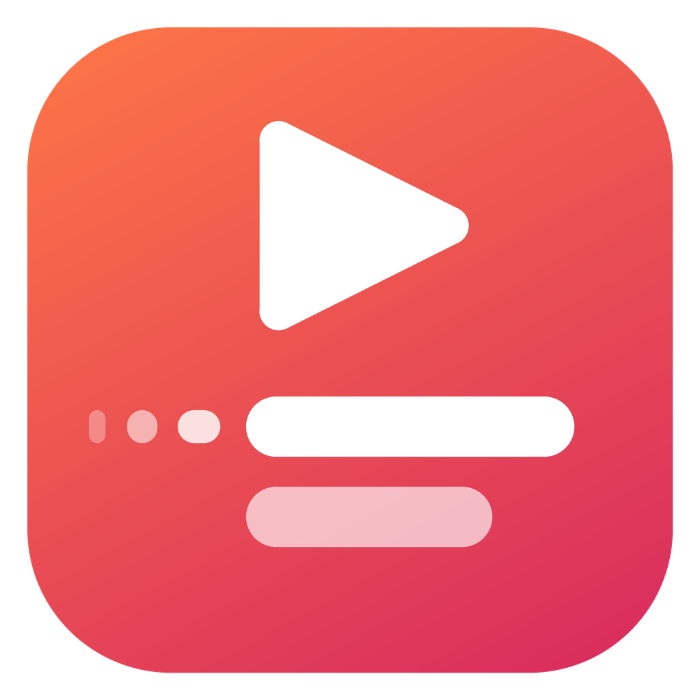
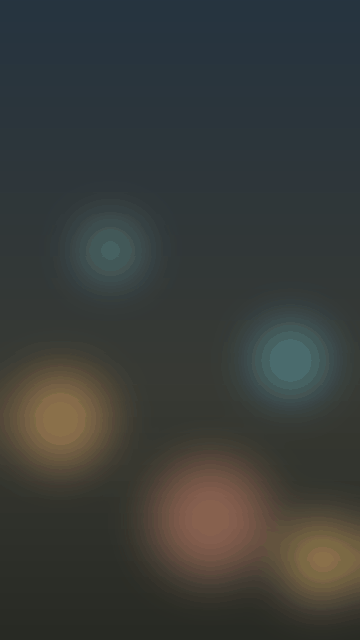
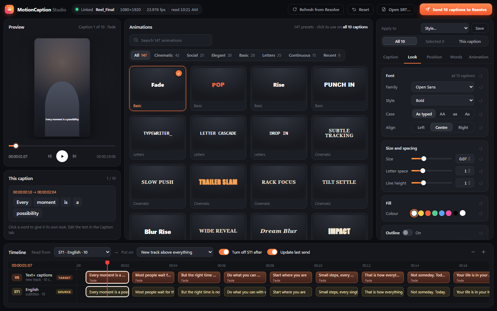
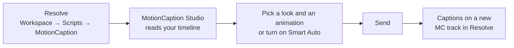

<div align="center">



# MotionCaption Studio

**Animated captions and supers for DaVinci Resolve, built for Resolve Free.**

Pick a look and an animation in the app, press Send, and they land on your timeline.

[](https://github.com/mahadeva112/MotionCaption/releases/latest)   



<sub>Frames drawn by the app itself: a letter-by-letter hook, a bouncing keyword, and a lower third coming out of a blur.</sub>

</div>

---

## Why

You can animate titles in Resolve, but each one takes Fusion work, and letter or word animations often don't show in Resolve Free. MotionCaption does that work for you:

- **Your subtitles, animated:** a subtitle track in Resolve, an `.srt` file, or Text+ titles you already placed.
- **Supers made in the app:** a hook title, a keyword, a lower third, a call to action.
- **147 animations,** previewed live on your own words.
- **Send** puts everything on a new video track. Nothing already on your timeline is moved or replaced.

<p align="center"></p>

## Features

| Feature | What it does |
|---|---|
| 🎬 **Finished clips** | The app draws each caption frame by frame, exactly as the preview shows it, and Resolve only places the clip. No Fusion is involved, so it works the same in Resolve Free and Studio. |
| ✍️ **Supers made here** | Add a super at the playhead, then write it, time it and style it. Supers keep their own look apart from your subtitles and are saved for each timeline. |
| 🧠 **Smart Auto** | Every caption gets an animation that suits it. The first line comes in as a hook, short lines hit hard, and long lines come in gently so they can be read. Never the same animation twice in a row. |
| 🎨 **147 animations** | Cinematic 42 · Letters 25 · Social 25 · Elegant 20 · Basic 20 · Continuous 15, plus word effects (pop, shake, glow, bounce). |
| 🔤 **Indian scripts** | Devanagari and Bangla letters animate whole, so a conjunct like **ध्या** or a vowel sign stays in one piece. If a font lacks the letters, the app switches to Nirmala UI. |
| ✨ **Word highlights** | Light up the last word, the longest word, the numbers, or every word in turn (karaoke). Or style any word yourself. |
| 🔁 **Patterns** | Let a few animations take turns over your captions, in order or at random. |
| 📱 **Safe areas** | Instagram Reels, YouTube Shorts and TikTok overlays, so captions don't end up under the buttons. |
| ♻️ **Update, don't redo** | Sending again only remakes the captions you changed. Anything you adjusted in Resolve on the others stays. |
| 🎞️ **Every frame rate** | 23.976, 24, 25, 29.97 (drop and non-drop), 30, 48, 50, 59.94 and 60 fps, with captions on their exact frames. |

## Install

1. Download **`MotionCaption-Studio-Setup-x.y.z.exe`** from the [latest release](https://github.com/mahadeva112/MotionCaption/releases/latest).
2. Run it. It installs the app and adds **MotionCaption** to Resolve's **Workspace → Scripts** menu.
3. The installer is not code-signed, so Windows SmartScreen may warn you. Choose **More info → Run anyway**.

You need Windows 10 or 11 and DaVinci Resolve (Free or Studio).

## Quick start



1. In Resolve, open your timeline and click **Workspace → Scripts → MotionCaption**. The app opens with the timeline's subtitle tracks, video tracks and Text+ titles.
2. Under **Read from**, pick where the captions come from:

   | Read from | What you get |
   |---|---|
   | `ST1 · Hindi` | A subtitle track |
   | `Text+ on V3` | Titles you placed yourself |
   | `Supers made here` | Supers you write in the app |

3. Pick a style in the **Look** tab and an animation in the library. Hover any animation to try it on your caption first.
4. Press **Send**. The app clicks MotionCaption in Resolve's menu for you, and the captions appear on a new **MC** track.

> **No subtitle track?** Click **Open SRT…** and use the file instead.

## Supers

1. Set **Read from** to **Supers made here**, then click **Add super**. The new super starts at the playhead and lasts 3 seconds.
2. In the **Caption** tab, write the text, set **Start** and **End** in seconds, or delete the super.
3. Style it and animate it like any caption. Supers start near the top, a bit larger, with a **Blur Rise** animation. Their settings stay apart from your subtitles'.
4. **Send.** The supers go in as finished clips, on their own track.

## Smart Auto

Open the **Animation** tab and pick a mood: **Calm**, **Energetic** or **Cinematic**. Then click **Turn on for all**.

| The caption is… | It gets… |
|---|---|
| The first line | The mood's hook entry: Wide Reveal, Slam Down, … |
| Long, or quick to read | A quiet entry, so there's time to read it |
| Short and strong, or has “!” | A hit: Impact, Stamp, Bounce Pop, … |
| Has a number | A punch, with the number lit up |
| A question | A sway: Drift, Wiggle, Grace, … |
| Any other line | The mood's everyday moves |

- Smart Auto picks only animations that fit the caption's length, and letter-by-letter ones only where every letter has time to arrive.
- **Shuffle** draws again from the same mood. **Turn off** gives every caption the one animation again.
- If you give a caption its own animation, it keeps it.

## Finished clips or Editable Text+

Choose this in the **Send** window:

| | **Finished clips** (default) | **Editable Text+** |
|---|---|---|
| How | The app draws transparent PNG frames; Resolve imports and places them | Resolve builds a Text+ title and animates it in Fusion |
| Looks in Resolve | Exactly like the preview | Close to the preview |
| Letter and word animations | Always show, in Free and Studio | Can fail to show in Resolve Free |
| Change the text later | In the app, then Send again | In the app, or by hand in Resolve |
| Needs | The timeline read from Resolve | Nothing extra |

The app keeps drawn frames, so a caption that hasn't changed is never drawn twice.

## Where things are kept

The app and the Resolve script talk through files in `%APPDATA%\MotionCaption\`:

| File | What it is |
|---|---|
| `job.lua` | What to place: written by the app on Send |
| `result.json` | What happened: written by the Resolve script |
| `bridge.log` | Every step of the last run. **Look here first when something is off** |
| `timeline.json` | The open timeline, read on every click in Resolve |
| `renders\` | Drawn frames, one folder per caption |

In Resolve's Media Pool, the script uses a **MotionCaption** bin:
- Its **Drawn** folder holds the finished clips.
- It also holds the Text+ templates, one per frame rate.

## Troubleshooting

- **The menu has no MotionCaption entry:** run the installer again, or press **Send** in the app. Either one puts the script in place. Then restart Resolve.
- **"DaVinci Resolve is not open":** start Resolve, open the project, then press **Send** again.
- **"The drawn frames came in at X fps":** set **Project Settings → Timeline frame rate** to your timeline's rate, then **Send** again.
- **A letter animation shows plain text in Resolve Free:** send with **Finished clips**.
- **Something else:** open `%APPDATA%\MotionCaption\bridge.log`. It says what Resolve did, step by step.

## Development

```bash
cd app
npm install
```

| Command | What it does |
|---|---|
| `npm run dev` | The full Electron app with hot reload |
| `npm run dev:web` | The UI alone in a browser, with a sample timeline (no Resolve needed) |
| `npm test` | Unit tests (Vitest) |
| `npm run typecheck` | TypeScript, no emit |
| `npm run dist` | Windows installer in `app/dist/` |

```
app/
├─ src/core/            caption logic, no UI: SRT, looks, layout, presets, Smart Auto, the job file
├─ src/main/            Electron main process; render.ts draws captions to PNG frames
├─ src/preload/         the API the page gets (window.mc)
├─ src/renderer/src/    React UI: preview, library, inspector, timeline, send
├─ resources/
│  ├─ MotionCaption.lua     the Resolve script: reads the timeline, places captions
│  ├─ run-in-resolve.ps1    presses the Resolve menu item through Windows UI Automation
│  └─ templates/            a Text+ template per frame rate
└─ scripts/             test jobs for Resolve (make-test-job.mts, drawn-test.mts)
```

### How it works

1. **The Resolve script reads the timeline.** Resolve Free can't be controlled from outside, so a click on **Workspace → Scripts → MotionCaption** runs `MotionCaption.lua` inside Resolve. It writes the open timeline to `timeline.json`.
2. **The app builds the job.** It turns each caption into exact keyframes (`core/compile.ts`) and, for finished clips, draws the frames. Then it writes `job.lua`.
3. **The app runs the script again.** It clicks the same menu item for you (`run-in-resolve.ps1`).
4. **The script places everything.** It puts the captions on new tracks and reports back in `result.json` and `bridge.log`.

### Testing in Resolve

Each script below writes a test job. That job builds on a **new test timeline** and saves still frames, so the look can be checked from images:

```bash
node scripts/make-test-job.mts          # every preset, as Text+
node scripts/drawn-test.mts request r.json
```

To finish the finished-clips test, build the app and let it draw the frames, then write the job:

```bash
npm run build && MC_RENDER_TEST=r.json npx electron .
node scripts/drawn-test.mts job r.json
```

Then click MotionCaption in Resolve. The results go to `bridge.log` and `%APPDATA%\MotionCaption\stills\`.

---

<div align="center"><sub>Made for editors who caption in Hindi, Bangla and English, on Resolve Free.</sub></div>
